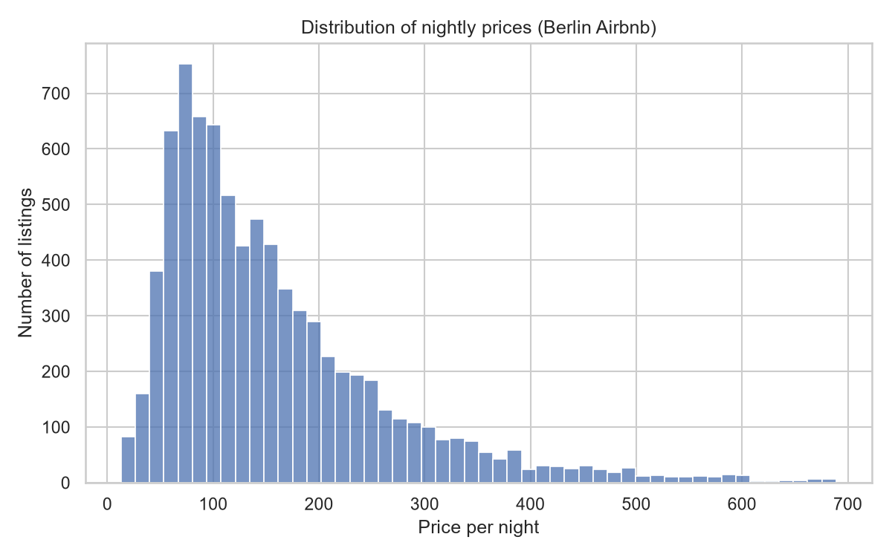
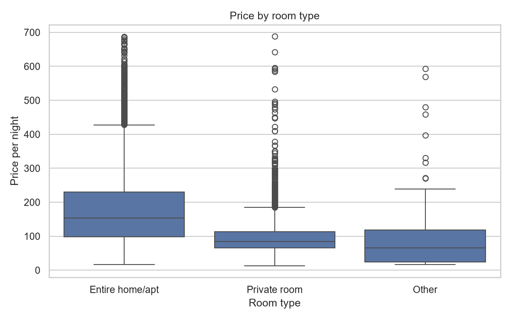
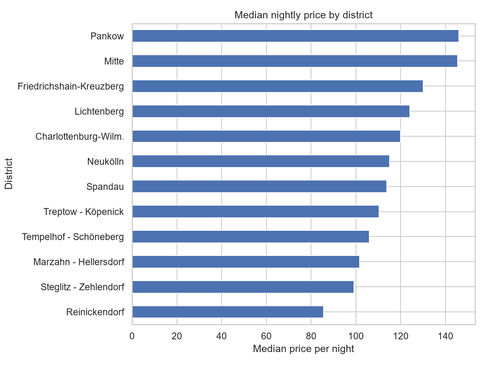
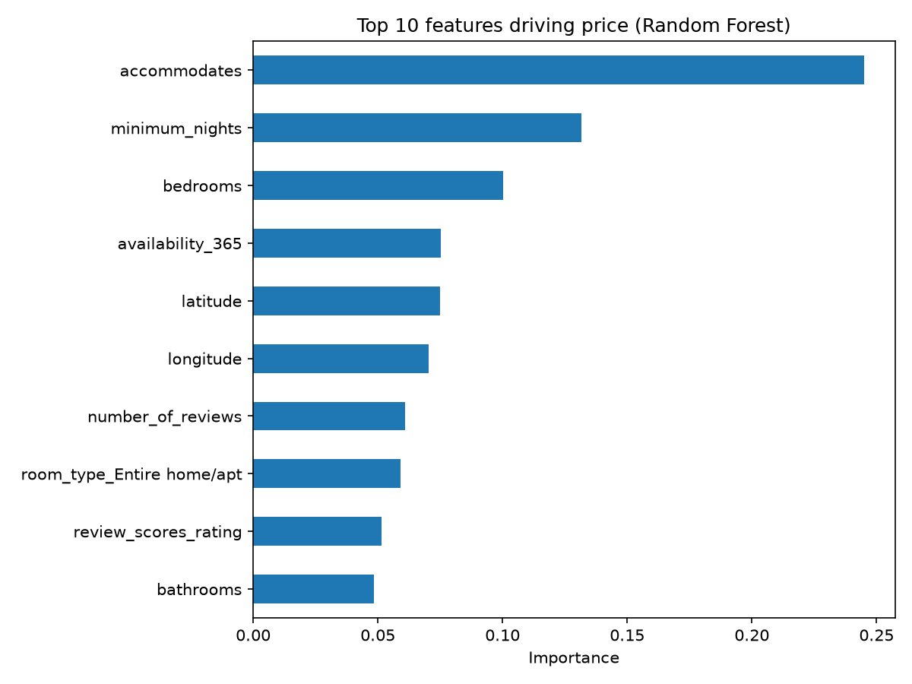

# Berlin Airbnb Price Analysis and Prediction

Predicts nightly Airbnb prices in Berlin from listing features and shows what drives price.
Built with Python, pandas, scikit-learn and seaborn.

## Key results
- Random Forest reached MAE 41.82, RMSE 63.29 and R2 0.650 on a held-out test set (20% of listings).
- It beat a median baseline (MAE 77.27) and Linear Regression (MAE 49.72, R2 0.555).
- Main price drivers: guests accommodated, minimum nights, bedrooms, availability and location.
- Entire homes have a median price of 154, private rooms 85.
- Pankow and Mitte have the highest median prices, Reinickendorf the lowest.

## Data
Inside Airbnb, Berlin detailed listings (scraped 2026-09-20): https://insideairbnb.com/get-the-data/
The data is not included in this repository. Download listings.csv.gz and place it in a folder called data.
Please check Inside Airbnb's license terms and credit them if you reuse the data. Prices are as listed in the dataset.

## Method
1. Cleaning: removed 4,219 listings without a price, converted price to numbers, extracted bathrooms from text, grouped rare room types, filled missing ratings with the median and added a has_reviews flag, and removed prices above the 99th percentile (691.20). 8,075 listings remain.
2. Exploration: charts of price distribution, room type, district, guest capacity and correlations (see images folder).
3. Modelling: 80/20 train-test split, one-hot encoding, a median baseline, Linear Regression and Random Forest.
4. Evaluation: MAE, RMSE and R2 on the test set.

## Charts

## Limitations
- One snapshot in time, so no seasonality.
- Prices are asking prices, not confirmed bookings.
- About a third of listings had no price and were excluded.
- No hyperparameter tuning yet, and feature importance shows association, not cause.

## Next steps
Tune the model, try gradient boosting, add text features from listing descriptions, and use calendar data.

## How to run
    pip install -r requirements.txt
    python prepare_data.py
    python make_charts.py
    python train_model.py

## Author
Khaliphile Dube, MSc Advanced Analytics student at SGH Warsaw School of Economics.
